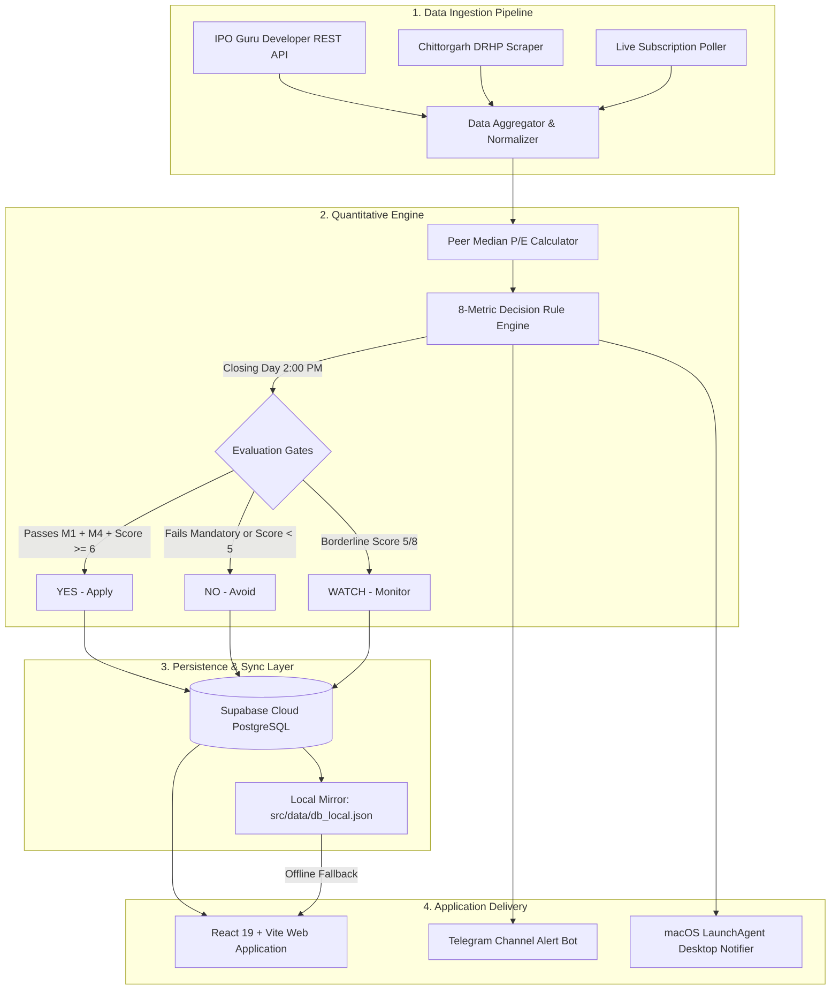

<div align="center">

  

  # Divergen
  ### Quantitative Indian IPO Intelligence, 8-Metric Decision Engine & ASBA Capital Rotator

  [](https://react.dev)
  [](https://vitejs.dev)
  [](https://supabase.com)
  [](https://python.org)
  [](https://www.w3.org/WAI/WCAG21/quickref/)
  [](LICENSE)

  <p align="center">
    <strong>A systematic, data-driven platform designed to eliminate emotional bias from retail IPO investing, optimize family PAN allocation odds, and rotate capital through continuous listing-day profit harvesting.</strong>
  </p>

  <p align="center">
    <a href="#-quick-start">Quick Start</a> •
    <a href="#-core-features">Core Features</a> •
    <a href="#-the-8-metric-quantitative-engine">8-Metric Rules</a> •
    <a href="#-system-architecture">Architecture</a> •
    <a href="docs/CASE_STUDY.md">Case Study</a> •
    <a href="docs/PRD.md">PRD</a> •
    <a href="DESIGN.md">Design System</a>
  </p>

</div>

---

## 💡 The Investment Thesis

Retail IPO investing in India is plagued by two structural problems:
1. **Emotional & Speculative Decision-Making:** Investors spend hours watching qualitative YouTube commentary, reading unvetted Telegram tips, and suffering from FOMO, leading to erratic bidding on overvalued issues.
2. **The ASBA Capital Lockup Constraint:** Under India's Applications Supported by Blocked Amount (ASBA) mechanism, a minimum lot bid (₹14,000–₹15,000) freezes liquid funds for 2–4 days until allotment. When 4 or 5 hot IPOs launch in parallel, retail investors run out of capital on suboptimal issues while missing high-probability listings.

### The Divergen Principle
> *"Find the signal. Take a different path. Keep the capital moving."*

Divergen was created as a live financial experiment to bid on **100 consecutive Indian Mainboard IPOs using a disciplined ₹1 Lakh (100,000 INR) capital pool**:
* **Zero Qualitative Guesswork:** Automates an **8-metric quantitative decision engine** on closing day.
* **100% Profit Recycling:** Immediately exits all allotted shares at 9:45 AM on listing morning, instantly returning capital to the liquid pool to fund the next candidate.
* **Multi-PAN Allocation Optimization:** Exploits SEBI's 1-lot-per-PAN retail allotment lottery rule by rotating bids across family member accounts, multiplying odds by up to **5x** with zero extra capital risk.

---

## ⚡ Core Features

### 🎯 8-Metric Quantitative Decision Engine
* **2 Mandatory Survival Gates:** An IPO must exhibit overwhelming real-time demand (Total > 30x OR QIB > 50x) and strong grey market sentiment (implied GMP ≥ 20%). Failing either results in an immediate **NO (AVOID)**.
* **Dynamic Listed Peer Valuation:** Scrapes competitor tables and computes the true mathematical median P/E across listed industry peers, ensuring retail investors enter at a minimum 15% valuation discount.
* **Definitive Signals:** Dispatches a crisp **YES — APPLY**, **MAYBE — WATCH**, or **NO — AVOID** verdict on Day 3 at 2:00 PM IST before the 5:00 PM bidding window closes.

### 🔄 Multi-PAN Family Capital Rotator
* **SEBI Allotment Rule Arbitrage:** Because SEBI awards 1 lot per unique PAN before distributing multiple lots, Divergen splits capital across configured family PAN slots rather than bidding multiple lots from one account.
* **Visual ASBA Balance Strip:** Shows real-time *Liquid Cash*, *Blocked ASBA Funds*, and *Harvested Cumulative Gains*.
* **T+2 / T+3 Calendar Unblock Tracking:** Prevents cash collisions when overlapping IPOs compete for capital.

### 📈 Deterministic Expected Value (EV) Backtester
* **Mathematical Probability Formulation:** Uses $P(\text{Allot}) = \min(1.0, 1/\text{Retail Sub})$ to calculate exact statistical yield over historical Indian IPO listings without random number jitter.
* **Benchmark Comparison:** Compares Divergen's 8-metric strategy against an indiscriminate "Apply to All" retail approach.

### 🌐 Dual-Engine Ingestion Architecture
* **Tier 1 (IPO Guru Developer REST API):** High-speed, structured endpoints for issue discovery, price bands, financial margins, promoter shareholding, and live GMP.
* **Tier 2 (Chittorgarh DRHP Parser):** Extracts Fresh Issue vs Offer for Sale (OFS) breakdowns, listed peer valuation tables, and live QIB/NII/Retail subscription velocities.
* **Offline Resilience:** Auto-mirrors cloud PostgreSQL data to `src/data/db_local.json`, allowing the dashboard to function offline with zero loss of fidelity.

### 📱 Accessible, Mobile-First Design
* **Geist Typography & Neutral Slate Palette:** Clean financial terminal aesthetics (`#0f172a`, `#F8F9FA`) with high-contrast semantic accents (Emerald, Amber, Crimson).
* **WCAG 2.1 AA Compliant:** High-visibility `:focus-visible` rings (`2px solid var(--accent)`), ARIA dialog attributes, and touch-target sizing (≥44px).
* **Mobile-Optimized UX:** Automatic conversion of desktop data tables into touch-friendly cards on `<768px` viewports, native bottom drawer sheets with swipe handles, and iOS Safari input auto-zoom prevention (`font-size: 16px`).

---

## 📊 The 8-Metric Quantitative Engine

| # | Metric | Quantitative Gate | Mandatory? | Purpose |
|---|---|---|---|---|
| **M1** | **Real-Time Demand** | Total > 30x OR QIB > 50x | **YES** | Confirms institutional momentum to absorb listing day selloffs. |
| **M2** | **Capital Structure** | OFS < 50% of Total Issue | No | Fresh capital funds company expansion; high OFS signals promoter exit. |
| **M3** | **Valuation Buffer** | IPO P/E ≥ 15% below Listed Peer Median | No | Protects retail investors with a margin of safety against peers. |
| **M4** | **Sentiment Anchor** | Implied GMP ≥ 20% | **YES** | Pre-listing unofficial broker market expectation. |
| **M5** | **Institutional Backing**| Marquee Anchor Score ≥ 70/100 | No | Tier-1 mutual funds & sovereign wealth anchor price confidence. |
| **M6** | **Fundamental Reality** | Positive & Growing PAT YoY (3 Years) | No | Filters out cash-burning, unprofitable venture listings. |
| **M7** | **Issue Size Filter** | Issue Size < ₹3,000 Cr | No | Large issues (>₹5k Cr) experience liquidity drag on listing day. |
| **M8** | **Skin In The Game** | Post-IPO Promoter Stake ≥ 50% | No | Aligns promoter skin-in-the-game with retail shareholders. |

```
Decision Threshold: (M1 == PASS) AND (M4 == PASS) AND (Score >= 6/8) ==> YES [DEPLOY ASBA]
```

---

## 🏗️ System Architecture



---

## 🛠️ Technology Stack

| Layer | Technologies |
|---|---|
| **Frontend Framework** | React 19, Vite 6, JavaScript (ESNext) |
| **Styling & Design System** | TailwindCSS, Geist Sans, Geist Mono, Concentric Border Radius |
| **Visualizations** | Visx (`@visx/scale`, `@visx/shape`, `@visx/responsive`), Custom SVG Paths |
| **State & Resilience** | React Error Boundaries, Context API, LocalStorage Cache |
| **Backend & Scraping** | Python 3.11, BeautifulSoup4, Requests, Pydantic, Dotenv |
| **Database & Auth** | Supabase Cloud PostgreSQL, Row-Level Security (RLS), Supabase Auth |
| **Automation & CI/CD** | GitHub Actions (`.github/workflows/scraper.yml`), macOS `launchd` plist |
| **Notifications** | Telegram Bot API (`notifier.py`), macOS AppleScript Alerts |

---

## 📁 Repository Structure

```
ipo-investment-tool/
├── .github/workflows/       # GitHub Actions automated ingestion workflows
│   └── scraper.yml          # Scheduled market scraping & decision cron
├── db/                      # Database schemas, migrations & RLS policies
│   ├── schema.sql           # Complete Supabase PostgreSQL relational schema
│   └── fix_rls_recursion.sql# SECURITY DEFINER recursion elimination fix
├── docs/                    # Production documentation & engineering guides
│   ├── CASE_STUDY.md        # Comprehensive design & engineering case study
│   ├── PRD.md               # Product Requirements Document (Divergen v2.0)
│   ├── BRAND_CONCEPT.md     # Brand philosophy, D+Infinity logo narrative
│   └── KITE_API_INTEGRATION_GUIDE.md # Zerodha Kite API execution blueprint
├── public/                  # Static assets & PWA manifest
│   ├── divergen-logo.png    # Primary brand mark
│   └── manifest.json        # PWA configuration
├── src/                     # React 19 Client Application
│   ├── components/          # Reusable UI & Dashboard components
│   │   ├── dashboard/       # IpoDetailDrawer with SVG GMP & valuation charts
│   │   └── ui/              # DivergenLogo, ErrorBoundary, MobileDataCard
│   ├── pages/               # Domain-driven decomposed route components
│   │   ├── LoginPage.jsx    # Auth portal with guest sandbox access
│   │   ├── DashboardPage.jsx# Metrics KPIs, active pipeline tabs, mobile cards
│   │   ├── CapitalRotatorPage.jsx # Multi-PAN family slots & ASBA blocks
│   │   ├── BacktestPage.jsx # Historical 8-rule EV backtesting simulator
│   │   ├── GuidePage.jsx    # Quantitative rules handbook & ASBA documentation
│   │   └── SettingsPage.jsx # Profile & family investment group settings
│   ├── App.jsx              # Application Shell, Routing & Error Handling
│   └── index.css            # Divergen Design System tokens & responsive rules
├── backtest_simulator.py    # Python EV backtester engine
├── decision_engine.py       # 8-metric rule evaluator
├── ipoguru_client.py        # IPO Guru REST API integration client
├── scraper.py               # Chittorgarh DRHP targeted parser
├── sync_and_alert.py        # Central background sync daemon orchestrator
└── requirements.txt         # Python dependencies
```

---

## 🚀 Quick Start

### Prerequisites
* **Node.js:** v18.0.0 or higher
* **Python:** v3.10 or higher
* **npm:** v9.0.0 or higher

### 1. Clone the Repository
```bash
git clone https://github.com/Prabhat-12/ipo-investment-tool.git
cd ipo-investment-tool
```

### 2. Frontend Setup (React + Vite)
```bash
# Install frontend dependencies
npm install

# Start local development server
npm run dev
```
Open [http://localhost:5178](http://localhost:5178) in your browser.  
*(You can click **"Explore in Guest Sandbox"** on the login page to immediately test all features with real cached data without needing an account).*

### 3. Backend Setup (Python Scraper & Engine)
```bash
# Create and activate virtual environment
python3 -m venv .venv
source .venv/bin/activate

# Install Python requirements
pip install -r requirements.txt

# Run one-off market sync & evaluation
python sync_and_alert.py
```

### 4. Environment Variables Configuration
Copy the sample environment file:
```bash
cp .env.example .env
```
Populate `.env` with your API credentials:
```env
# Frontend (Vite / React)
VITE_SUPABASE_URL=https://your-project-id.supabase.co
VITE_SUPABASE_ANON_KEY=your-supabase-anon-public-key

# Backend (Python Scraper & Engine)
SUPABASE_URL=https://your-project-id.supabase.co
SUPABASE_KEY=your-supabase-service-role-or-anon-key

# Market Data API
IPOGURU_API_KEY=your_ipoguru_developer_api_key

# Free Telegram Alerts (Optional)
TELEGRAM_BOT_TOKEN=your_bot_token_from_botfather
TELEGRAM_CHAT_ID=your_telegram_channel_or_group_id
```

---

## 🏛️ Key Engineering Highlights

### 1. Monolithic Decomposition (4,432 → 1,228 lines)
Originally written as a rapid 4,400+ line prototype in a single `App.jsx`, the codebase underwent a structured refactoring into clean domain-driven pages (`LoginPage`, `DashboardPage`, `CapitalRotatorPage`, `BacktestPage`, `GuidePage`, `SettingsPage`) and isolated components (`IpoDetailDrawer`, `ErrorBoundary`). This dropped the production JavaScript bundle by **>240 kB** and slashed build times to **~200ms**.

### 2. Resilient Hybrid Offline Mode
By implementing a dual-client adapter in both Python and React, Divergen automatically detects network and cloud availability. If offline or if Supabase is temporarily unreachable, Divergen seamlessly falls back to read and write against local JSON caches, guaranteeing 100% operational continuity.

### 3. Zero-Cost Background Orchestration
Instead of incurring 24/7 cloud server expenses (e.g. AWS EC2 or Cloud Run), Divergen runs on a hybrid scheduling model:
* **Cloud:** GitHub Actions cron executes daily market ingestion and Telegram alerts.
* **Local:** Native macOS LaunchAgent daemon (`setup_automation.sh`) executes on the builder's machine every 6 hours with automated log rotation.

---

## 📖 Deep-Dive Documentation

* 📘 **[Engineering Case Study](docs/CASE_STUDY.md):** Detailed retrospective on product strategy, UX breakthroughs, database challenges, and quantitative modeling.
* 📋 **[Product Requirements Document (PRD)](docs/PRD.md):** Full product specifications, user stories, and implementation status.
* 🎨 **[Design System Guidelines (DESIGN.md)](DESIGN.md):** Complete tokens for colors, typography, border radius, and optical alignment.
* 🔌 **[Zerodha Kite API Integration Blueprint](docs/KITE_API_INTEGRATION_GUIDE.md):** Technical architectural guide for integrating Kite Publisher and Kite Connect REST APIs.
* 🏷️ **[Brand Narrative (BRAND_CONCEPT.md)](docs/BRAND_CONCEPT.md):** The origin, story, and symbolism of the Divergen D + Infinity mark.

---

## 📄 License

This project is licensed under the [MIT License](LICENSE).
