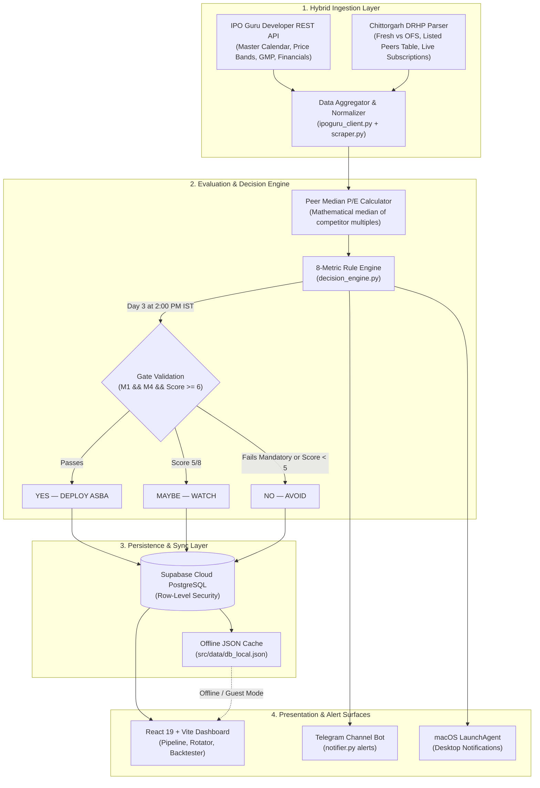

<div align="center">

  

  # Divergen
  ### Quantitative Indian IPO Intelligence, 8-Metric Decision Engine & ASBA Capital Rotator

  <p align="center">
    A data-driven platform designed to eliminate emotional bias from retail IPO investing, optimize family PAN allocation odds, and rotate capital through continuous listing-day profit harvesting.
  </p>

  <p align="center">
    <a href="#the-investment-thesis">Investment Thesis</a> •
    <a href="#the-8-metric-quantitative-engine">8-Metric Rules</a> •
    <a href="#system-architecture">System Architecture</a> •
    <a href="#technical-stack">Technical Stack</a> •
    <a href="docs/CASE_STUDY.md">Case Study</a> •
    <a href="docs/PRD.md">Product Requirements</a> •
    <a href="DESIGN.md">Design System</a>
  </p>

</div>

---

## The Investment Thesis

Retail IPO participation in India is hindered by two structural challenges:

1. **Emotional and Speculative Bidding:** Retail investors frequently rely on sensationalist financial media, unvetted Telegram channels, and informal grey market chatter. Without disciplined evaluation, capital is often committed to overvalued, cash-burning companies.
2. **The ASBA Capital Lockup Constraint:** Under SEBI's Applications Supported by Blocked Amount (ASBA) mechanism, a retail lot bid (typically ₹14,000–₹15,000) blocks liquid funds for 2 to 4 days until the basis of allotment is finalized. When several high-interest issues launch concurrently, retail investors exhaust their liquid reserves on lower-quality offerings while missing high-probability listings.

### Core Operating Principle
> *"Find the signal. Take a different path. Keep the capital moving."*

Divergen was created as a live financial experiment to participate in **100 consecutive Indian Mainboard IPOs using a disciplined ₹1 Lakh (100,000 INR) capital pool**:
* **Quantitative Discipline:** Evaluates candidates against an automated **8-metric scoring system** on the final bidding day once institutional numbers mature.
* **100% Listing Morning Exit:** Sells all allocated shares at 9:45 AM on listing day, immediately recycling proceeds back into the liquid ASBA pool to fund subsequent candidates.
* **Multi-PAN Allocation Optimization:** Leverages SEBI's proportionate 1-lot-per-PAN retail allotment rule. By distributing bids across configured family PAN slots rather than bidding multiple lots from a single account, allotment probability is multiplied by up to **5x** with zero extra capital risk.

---

## Core Capabilities

### Quantitative Decision Engine
* **Mandatory Survival Gates:** Evaluates issues against two non-negotiable gates: institutional demand (Total > 30x or QIB > 50x) and grey market sentiment (implied GMP ≥ 20%). Failing either results in an immediate **NO (AVOID)**.
* **Dynamic Listed Peer Valuation:** Scrapes competitor tables and computes the true mathematical median P/E across listed industry peers, ensuring retail investors enter at a minimum 15% valuation discount.
* **Timely Signals:** Dispatches definitive **YES (DEPLOY ASBA)**, **MAYBE (WATCH)**, or **NO (AVOID)** verdicts on Day 3 at 2:00 PM IST before bidding windows close at 5:00 PM.

### Multi-PAN Family Capital Rotator
* **SEBI Allotment Rule Arbitrage:** Allocates 1 lot per family member PAN across configured profiles, maximizing lottery hit rates.
* **ASBA Balance Tracking:** Real-time visibility across *Liquid Capital*, *Blocked ASBA Funds*, and *Harvested Cumulative Gains*.
* **T+2 / T+3 Calendar Projection:** Visualizes lockup windows to prevent cash collisions when multiple listings overlap.

### Deterministic Expected Value Backtester
* **Mathematical Probability Formulation:** Uses $P(\text{Allot}) = \min(1.0, 1/\text{Retail Sub})$ to calculate exact statistical yield over historical Indian IPO listings without random number jitter.
* **Benchmark Comparison:** Directly compares Divergen's selective 8-metric strategy against an indiscriminate "Apply to All" retail approach.

### Dual-Engine Ingestion Pipeline
* **Tier 1 (IPO Guru Developer REST API):** High-speed, structured endpoints for issue discovery, price bands, financial margins, promoter shareholding, and live GMP.
* **Tier 2 (Chittorgarh DRHP Parser):** Scrapes Fresh Issue vs Offer for Sale (OFS) breakdowns, listed peer valuation tables, and live QIB/NII/Retail subscription velocities.
* **Dual-Layer Persistence:** Writes to Supabase Cloud PostgreSQL while auto-mirroring records to `src/data/db_local.json` for 100% offline and guest sandbox operation.

### Accessible, Mobile-First User Experience
* **Geist Typography & Slate Palette:** Built with neutral slate design tokens (`#0f172a`, `#F8F9FA`) and high-contrast semantic indicators (Emerald, Amber, Crimson).
* **WCAG 2.1 AA Compliant:** High-visibility `:focus-visible` rings (`2px solid var(--accent)`), ARIA dialog attributes, and touch-target sizing (≥44px).
* **Mobile-Optimized Layouts:** Single-column card stacks on viewports `<768px`, full-screen bottom drawer sheets with touch handles, and zero iOS Safari input auto-zoom (`font-size: 16px`).

---

## The 8-Metric Quantitative Engine

| # | Metric | Quantitative Gate | Mandatory? | Strategic Purpose |
|---|---|---|---|---|
| **M1** | **Real-Time Demand** | Total > 30x OR QIB > 50x | **YES** | Confirms institutional momentum to absorb listing day selloffs. |
| **M2** | **Capital Structure** | OFS < 50% of Total Issue | No | Fresh capital funds company expansion; high OFS signals promoter cash-out. |
| **M3** | **Valuation Buffer** | IPO P/E ≥ 15% below Listed Peer Median | No | Protects retail investors with a margin of safety against peers. |
| **M4** | **Sentiment Anchor** | Implied GMP ≥ 20% | **YES** | Pre-listing unofficial broker market expectation. |
| **M5** | **Institutional Backing**| Marquee Anchor Score ≥ 70/100 | No | Tier-1 mutual funds & sovereign wealth anchor price confidence. |
| **M6** | **Fundamental Reality** | Positive & Growing PAT YoY (3 Years) | No | Filters out cash-burning, unprofitable venture listings. |
| **M7** | **Issue Size Filter** | Issue Size < ₹3,000 Cr | No | Large issues (>₹5,000 Cr) experience liquidity drag on listing day. |
| **M8** | **Skin In The Game** | Post-IPO Promoter Stake ≥ 50% | No | Aligns promoter incentives with retail shareholders. |

```
Evaluation Formula:
Decision = (M1 == PASS) AND (M4 == PASS) AND (Score >= 6/8) ? "YES" : (Score == 5 ? "WATCH" : "NO")
```

---

## System Architecture

The following diagram illustrates Divergen's data ingestion, evaluation pipeline, persistence model, and multi-surface delivery:



---

## Technical Stack

| Architectural Layer | Technologies |
|---|---|
| **Frontend Framework** | React 19, Vite 6, JavaScript (ESNext) |
| **Design System & Styling** | TailwindCSS, Geist Sans, Geist Mono, Concentric Border Radius |
| **Visualizations & Charts** | Visx (`@visx/scale`, `@visx/shape`, `@visx/responsive`), SVG Path Calculations |
| **Fault Isolation & State** | React Error Boundaries, Context API, LocalStorage Cache |
| **Backend & Ingestion** | Python 3.11, BeautifulSoup4, Requests, Pydantic, Dotenv |
| **Database & Auth** | Supabase Cloud PostgreSQL, Row-Level Security (RLS), Supabase Auth |
| **Automation & Daemons** | GitHub Actions (`scraper.yml`), macOS `launchd` LaunchAgent |
| **Alert Infrastructure** | Telegram Bot API (`notifier.py`), macOS AppleScript |

---

## Architectural & Engineering Decisions

For an in-depth retrospective on the design challenges, systems engineering, and implementation trade-offs, refer to the project documentation:

* **[Engineering Case Study](docs/CASE_STUDY.md):** Deep-dive covering the origin prompt, the monolithic `App.jsx` decomposition (reducing 4,432 lines down to 1,228 lines and cutting 240 kB from the production bundle), PostgreSQL RLS recursion debugging via `SECURITY DEFINER`, and deterministic Expected Value backtesting models.
* **[Product Requirements Document](docs/PRD.md):** Formal specification of the dual-engine pipeline, 8 quantitative rules, and product roadmap.
* **[Design System Guidelines](DESIGN.md):** Design tokens, typography standards, concentric border radii, and accessibility rules.
* **[Broker Integration Blueprint](docs/KITE_API_INTEGRATION_GUIDE.md):** Technical review of Zerodha Kite Connect APIs, retail UPI ASBA 2FA regulatory constraints, and listing-day GTT exit workflows.
* **[Brand Narrative](docs/BRAND_CONCEPT.md):** Brand philosophy and the symbolism behind the Divergen D + Infinity mark.

---

## License

This project is licensed under the [MIT License](LICENSE).
