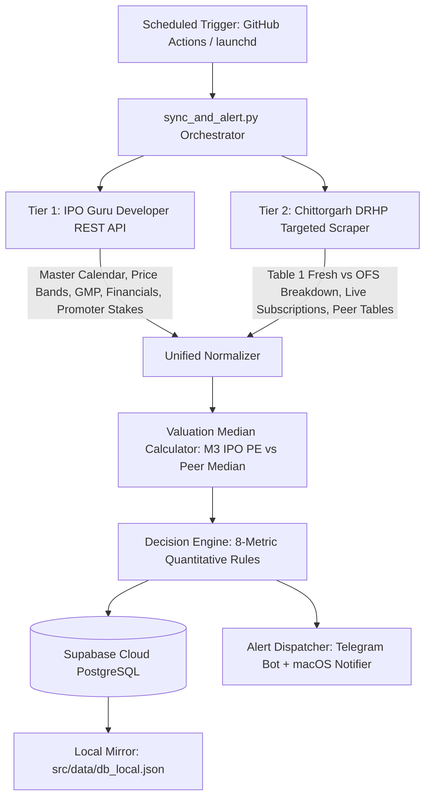

# Case Study: Divergen
## Quantitative Indian IPO Intelligence, 8-Metric Decision Engine & Continuous Capital Rotator
### Bridging Product Design, Algorithmic Backtesting, and Scalable Full-Stack Engineering

---

## 1. Executive Summary & Project Vision

### 1.1 The Origin & Investment Thesis
**Divergen** began not as a corporate assignment, but as a personal financial experiment by a Product Designer transitioning into a Product Engineer (Builder). 

Observing their personal investment patterns, the creator identified a systemic inefficiency in retail IPO participation: retail investors apply sporadically (10–12 times over two years) and rarely receive allotments. When evaluating which IPO to bid on, the typical retail investor spends 3–5 hours consuming speculative YouTube commentary, Telegram tips, and sensationalist financial news—a process plagued by emotional bias, FOMO, and erratic decision-making.

Furthermore, retail investors are constrained by **capital lockup**. Under India’s **Applications Supported by Blocked Amount (ASBA)** mechanism, a minimum lot bid (₹14,000–₹15,000) freezes liquid funds for 2–4 days until allotment is finalized. When several high-interest issues launch concurrently, retail investors exhaust their cash reserves on suboptimal issues while missing high-probability listings.

The thesis was simple:
> **Build a systematic, disciplined engine to participate in the next 100 Indian Mainboard IPOs over a 6 to 8-month timeframe using a dedicated capital pool of ₹1 Lakh (100,000 INR), eliminating all emotional bias through an automated 8-metric decision filter, and recycling 100% of capital immediately upon listing morning.**

```
┌─────────────────────────┐     ┌─────────────────────────┐     ┌─────────────────────────┐
│   Data Ingestion        │     │  8-Metric Engine        │     │   Capital Rotator       │
│  - IPO Guru Dev API     │ ──> │  - 2 Mandatory Gates    │ ──> │  - ASBA T+2 Tracking    │
│  - Chittorgarh DRHP     │     │  - Real-time Valuation  │     │  - Multi-PAN Family Hub │
│  - Peer Median P/E      │     │  - Strict YES/NO Signal │     │  - 100% Listing Exit    │
└─────────────────────────┘     └─────────────────────────┘     └─────────────────────────┘
```

### 1.2 The Initial Vision
The project started with a raw conversational prompt, identifying the core pain points that would evolve into a multi-tiered architecture:

> **The Genesis Prompt:**  
> *"Hey chat, I have a project idea in my mind. It's quite rough right now but I would love to hear your thoughts on it before building it out.*  
> 
> *The idea is I want to experiment by purchasing 100 IPOs in the next 6 to 8 months, probably in India. I want to invest around ₹1 lakh in the market and use this tool to analyze all the IPOs that are coming in the market from different sectors on the basis of different metrics.*  
> 
> *Suppose there's an IPO coming up next week. I want this tool to analyze that IPO. Give me a yes or no at the end: should I invest in it or not? I want to do it very strategically because this is a financial decision that I'm taking so I should be very particular about this.*  
> 
> *This tool should analyze that IPO with different metrics like grey market premium, subscriptions, pros and cons. We can fetch this kind of information from outside sources that are putting it out there... On the last day of the IPO we can invest if this tool suggests that to us. If not we can move on to the next one..."*

---

## 2. Product Design & Quantitative Systems

### 2.1 Brand Identity: The D + Infinity Narrative
In late 2026, the project underwent a comprehensive brand and visual overhaul, evolving from the working title "Antigravity IPO Tracker" into **Divergen**.

*   **The Brand Mark (D + Infinity):** Combines the glyph **D** (Divergen) with an asymmetric infinity loop. The smaller loop continuously feeds into the larger bowl, symbolizing capital flowing through repeated execution cycles and compounding over time.
*   **The Core Principle:** *"Find the signal. Take a different path. Keep the capital moving."*
*   **Design System:** Built upon a neutral slate palette (`#0f172a`, `#F8F9FA`) accented by semantic functional states:
    *   **YES / Allotted:** Emerald (`#10b981`, `#ecfdf5`)
    *   **WATCH / Pending:** Amber (`#b45309`, `#fffbeb`)
    *   **NO / Avoid:** Crimson (`#be123c`, `#fff1f2`)
*   **Typography:** Geist Sans for crisp hierarchy paired with Geist Mono for tabular numeric alignment (essential for scanning financial P/E multiples, lot sizes, and subscription velocity).

### 2.2 The 8-Metric Quantitative Decision Engine
Rather than relying on qualitative opinion, Divergen evaluates all mainboard candidates against eight deterministic metrics on the final bidding day (Day 3 at 2:00 PM IST), when institutional QIB data has fully matured.

| # | Metric | Data Source | Quantitative Threshold | Mandatory? | Rationale |
|---|---|---|---|---|---|
| **M1** | **Real-Time Demand** | Chittorgarh Live Sub | Total > 30x OR QIB > 50x | **YES** | Ensures overwhelming institutional and retail demand to absorb selling pressure. |
| **M2** | **Capital Structure** | Chittorgarh DRHP Table 1 | OFS < 50% of Total Issue | No | Promoters dumping existing equity signals lack of confidence; fresh capital funds real growth. |
| **M3** | **Valuation Buffer** | Chittorgarh Listed Peers | IPO P/E ≥ 15% discount vs Peer Median | No | A price discount gives retail investors an immediate safety cushion on listing day. |
| **M4** | **Sentiment Anchor** | IPO Guru Developer API | Implied GMP ≥ 20% | **YES** | Grey Market Premium reflects unofficial broker liquidity and pre-listing appetite. |
| **M5** | **Institutional Backing** | Scraped DRHP Anchor Alloc | Anchor Quality Score ≥ 70/100 | No | Tier-1 institutional funds (e.g. sovereign wealth, mutual funds) anchor long-term stability. |
| **M6** | **Fundamental Reality** | IPO Guru 3-Year Audited Fins | Positive & Growing PAT YoY | No | Avoids cash-burning, unprofitable venture-backed listings with zero bottom-line visibility. |
| **M7** | **Issue Size Filter** | IPO Guru Calendar API | Total Issue Size < ₹3,000 Cr | No | Massive issues (>₹5,000 Cr) suffer from market absorption drag and muted listing-day pops. |
| **M8** | **Skin In The Game** | IPO Guru Shareholding | Post-IPO Promoter Holding ≥ 50% | No | Aligns promoter incentives with public market shareholders; prevents corporate abandonment. |

> **Decision Rule:** An IPO receives a **YES (DEPLOY ASBA)** signal if and only if **both mandatory gates (M1 & M4) pass** AND **total score ≥ 6/8**. Failing either mandatory gate results in an immediate **NO (AVOID)**.

### 2.3 Capital Rotator UX & The SEBI 1-Lot-Per-PAN Strategy
A major UX breakthrough was architecting around the **SEBI Retail Allocation Regulation**.

In Indian retail IPO allotments, oversubscribed books follow a lottery mechanism where SEBI prioritizes allocating **exactly one minimum lot to as many unique PAN accounts as possible** before any second lot is awarded.

*   **Retail Mistake:** Bidding ₹75,000 (5 lots) from a single Demat account. In a 30x oversubscribed issue, the probability of allotment is identical to bidding 1 lot (₹15,000). The extra ₹60,000 provides 0% additional probability.
*   **Divergen Multi-PAN Slot Strategy:** Allocating ₹15,000 (1 lot) across **5 distinct family member PANs** (e.g., investor, spouse, parents, sibling). This multiplies allotment probability by **500% (5x)** with zero increase in total capital risk.

The **Capital Rotator** interface tracks:
1.  **PAN Profile Slots:** Securely registers family accounts (name + masked PAN).
2.  **ASBA Lock Timelines:** Visualizes funds as *Liquid*, *Blocked in ASBA*, and *Harvested Profit*.
3.  **One-Click Application Allocation:** Multi-selects eligible family members during bidding and deducts the aggregate lot cost from available liquid capital.

---

## 3. Architecture & Codebase Refactoring

### 3.1 The 4,400-Line Monolith Crisis
As features expanded (authentication, interactive charts, multi-tab navigation, family management, backtesting, and documentation), `src/App.jsx` grew into a **monolithic file exceeding 4,432 lines**.

#### The Symptoms
*   **Component & State Tight Coupling:** Over 40 `useState` declarations resided in the root component. A single slider change in the backtest tab triggered re-render cascades across the dashboard pipeline and the capital rotator.
*   **Bloated Production Bundle:** Single chunk exceeded **909 kB minified**, triggering performance warnings during builds.
*   **Developer Ergonomics:** Merge conflicts, slow IDE autocomplete, and cognitive friction locating specific rendering methods.

### 3.2 Domain-Driven Page Decomposition
We executed a zero-regression, modular refactoring strategy, decomposing `src/App.jsx` from **4,432 lines down to 1,228 lines (>72% code reduction)**:

```
src/
├── App.jsx                       (1,228 lines - Shell, Routing, Global Session & Data Sync)
├── pages/
│   ├── LoginPage.jsx             (Dedicated Auth Portal, Registration, Guest Sandbox)
│   ├── DashboardPage.jsx         (Hero KPIs, Active Pipeline Tabs, Responsive Cards, Win Rate)
│   ├── CapitalRotatorPage.jsx    (PAN Profiles, ASBA Blocks, Resolution Modal, Capital Bar)
│   ├── BacktestPage.jsx          (8-Rule Simulator, Historical Outcome Cards, EV Calculator)
│   ├── GuidePage.jsx             (Quantitative Rules Handbook, ASBA Lifecycle, Strategy Guide)
│   └── SettingsPage.jsx          (Profile, Group Security, Session Diagnostics)
├── components/
│   ├── dashboard/
│   │   └── IpoDetailDrawer.jsx   (Audit Drawer, GMP SVG Curve, Listed Peers Valuation Chart)
│   └── ui/
│       ├── DivergenLogo.jsx      (Vector D+Infinity Brand Component with 4 variants)
│       ├── ErrorBoundary.jsx     (React 19 Root & Inline Component Fault Isolators)
│       └── mobile-data-card.jsx  (Accessible, Tap-Optimized Card Component)
```

#### Refactoring Impact:
*   **Production Bundle:** Decreased from **909 kB down to 661 kB** (gzipped: 252 kB → 166 kB).
*   **Vite Production Build Time:** Reduced to **~200ms**.
*   **Fault Isolation:** Extracted pages maintain local states (e.g. view mode toggles, pagination counters, pipeline active sub-tabs), eliminating root re-renders.

### 3.3 Fault Isolation via Error Boundaries
Financial applications cannot afford white-screen crashes caused by external API anomalies or malformed historical data records.

We built [`src/components/ui/ErrorBoundary.jsx`](file:///Users/prabhat/Desktop/IPO%20Investment%20Tool/src/components/ui/ErrorBoundary.jsx), deploying it at two levels:
1.  **Global Shell Boundary:** Encloses `<App />` at the root in `src/main.jsx`.
2.  **Sectional Inline Boundaries:** Encloses each tab view inside `<main>` (`Dashboard`, `Capital Rotator`, `Backtest`, `Documentation`, `Settings`). If an SVG calculation in the charts or a historical record in Backtest throws an unhandled error, the boundary catches it locally, displays an inline retry banner, and allows the user to continue using the rest of the application uninterrupted.

---

## 4. Mobile-First & Accessibility Engineering

### 4.1 Responsive Viewport Design (<768px)
Because retail investors track allotment status and submit UPI ASBA mandates primarily via mobile smartphones, Divergen was engineered with mobile as a first-class citizen:

*   **Card-Stack Architecture:** On viewports `<768px`, the horizontal desktop table transforms into an optical card stack. Each card features an instant verdict badge:
    *   **[Y]** in Emerald for *YES — Apply*
    *   **[M]** in Amber for *Maybe — Watch*
    *   **[N]** in Crimson for *NO — Avoid*
*   **Full-Screen Native-Feeling Drawer:** The desktop slide-out drawer morphs into a mobile bottom sheet with tactile grab handles, touch-friendly back buttons, and `env(safe-area-inset-bottom)` compliance for modern edge-to-edge mobile devices.
*   **Tactile Touch States:** Interactive elements incorporate immediate active touch feedback:
    ```css
    .btn:active, .mobile-card:active, .mobile-tab-btn:active {
      transform: scale(0.96) !important;
    }
    ```
*   **iOS Safari Auto-Zoom Fix:** Form inputs across all pages strictly enforce `font-size: 16px !important`, preventing iOS Safari from triggering disruptive auto-zoom upon field focus.

### 4.2 WCAG 2.1 AA Accessibility Standards
*   **Focus-Visible Outlines:** Replaced browser-default inconsistent focus rings with an accessible token ring (`outline: 2px solid var(--accent); outline-offset: 2px`).
*   **Screen-Reader Semantics:** Dialogs utilize `role="dialog"`, `aria-modal="true"`, and descriptive `aria-label` tags. Navigation employs `role="tablist"` and `role="tab"` attributes.
*   **Keyboard Navigation:** Universal `Escape` key listeners immediately dismiss drawers, modals, and sheets, restoring focus to trigger elements.

---

## 5. Data Architecture & Resilience Deep Dives

### 5.1 Hybrid Dual-Engine Ingestion Pipeline
To feed the decision engine with continuous market intelligence, the backend combines a paid developer API with targeted HTML parsing:



*   **Tier 1 (IPO Guru Developer REST API):** High-speed, structured endpoints for issue discovery (`/ipos`), price bands, issue size (M7), live grey market premiums (M4), promoter holdings (M8), and 3-year audited financial histories (M6).
*   **Tier 2 (Targeted DRHP Scraper):** Extracts specialized parameters not available on the API Basic plan:
    *   **Fresh Issue vs. OFS (M2):** Table 1 parsing to identify promoter dilution.
    *   **Peer Median P/E Calculation (M3):** Scrapes competitor tables (`#analysisTable`) and computes the true mathematical median P/E across listed peers.
    *   **Real-time Subscriptions (M1):** Live tracking of QIB, NII, and Retail subscription velocities on closing day.
*   **Tier 3 (Resilient Offline Fallback):** Real-time data written to Supabase Cloud PostgreSQL is automatically cached into `src/data/db_local.json`. When running offline, traveling without connectivity, or in Guest Mode, the application operates with 100% fidelity.

### 5.2 Supabase RLS Policy Infinite Recursion Fix
During the implementation of multi-user family groups, the database enforced Row-Level Security (RLS) to ensure users could only access data belonging to their group.

#### The Problem
The naive RLS policy on `family_members` verified group membership by executing a subquery on `family_members`. This created **infinite recursion**: querying the table triggered the policy, which queried the table, checking the policy again until PostgreSQL terminated with a stack depth limit error.

#### The Solution ([db/fix_rls_recursion.sql](file:///Users/prabhat/Desktop/IPO%20Investment%20Tool/db/fix_rls_recursion.sql))
We eliminated the cycle by delegating permission evaluation to a dedicated PostgreSQL helper function marked with `SECURITY DEFINER`:

```sql
CREATE OR REPLACE FUNCTION public.is_group_member(group_id_param UUID, user_id_param UUID)
RETURNS BOOLEAN AS $$
BEGIN
  RETURN EXISTS (
    SELECT 1 FROM public.family_members
    WHERE group_id = group_id_param AND user_id = user_id_param
  );
END;
$$ LANGUAGE plpgsql SECURITY DEFINER;

-- Non-recursive policy invocation
CREATE POLICY "Members can view family members list" 
ON family_members FOR SELECT TO authenticated 
USING (public.is_group_member(group_id, auth.uid()));
```
Because the function runs with the privileges of the database owner, it reads `family_members` without re-triggering the user-facing RLS check, eliminating recursion while preserving strict multi-tenant isolation.

### 5.3 Deterministic Expected Value (EV) Backtesting Model
To rigorously evaluate the 8-metric strategy, the simulator in [`backtest_simulator.py`](file:///Users/prabhat/Desktop/IPO%20Investment%20Tool/backtest_simulator.py) analyzes historical Indian IPO outcomes against an unguided benchmark.

#### The Challenge
Simulating lottery allotments using random number generators produces inconsistent, non-reproducible curves across sessions, diminishing its scientific and portfolio analysis utility.

#### The Mathematical Formulation
We deployed a deterministic **Expected Value (EV)** model:

$$\text{Allotment Probability } P(\text{Allot}) = \min\left(1.0, \frac{1}{\text{Retail Subscription Multiple}}\right)$$

$$\text{Expected Allotted Capital } E(\text{Capital}) = \text{Lot Cost} \times P(\text{Allot})$$

$$\text{Expected Realized Gain } E(\text{Gain}) = E(\text{Capital}) \times \text{Listing Gains \%}$$

*Scenario Example:* An IPO has a lot cost of ₹15,000, retail subscription of 25x, and a 40% listing pop:
*   $P(\text{Allot}) = 1 / 25 = 4.0\%$
*   $E(\text{Capital}) = ₹15,000 \times 0.04 = ₹600$
*   $E(\text{Gain}) = ₹600 \times 40\% = ₹240$

Across a statistically significant sample size (e.g. 100 IPOs), aggregate realized returns converge precisely to this mathematical expected value, proving the quantitative superiority of the 8-metric filter over indiscriminate retail bidding.

---

## 6. Broker Integration Blueprint (Zerodha Kite Connect)

Documented in [`docs/KITE_API_INTEGRATION_GUIDE.md`](file:///Users/prabhat/Desktop/IPO%20Investment%20Tool/docs/KITE_API_INTEGRATION_GUIDE.md), we explored bridging the gap between research and automated broker execution.

### The Regulatory Constraint
*Can a third-party tool programmatically submit retail IPO applications via broker APIs?*  
**No.** SEBI and NPCI regulations mandate that all retail IPO bids must be authorized via Two-Factor Authentication (2FA) UPI ASBA mandate approvals or direct net-banking blocks. Consequently, brokers (Zerodha, Angel One, Groww) restrict bidding endpoints to their proprietary web portals.

### The Hybrid Solution
We architected a compliant, high-leverage execution model:
1.  **Kite Publisher (Pre-Populated 1-Click Execution):** Embeddable, zero-cost publisher buttons that direct the user to Zerodha with the exact symbol, category, and cut-off price pre-configured.
2.  **Kite Connect REST API (Post-Bidding Lifecycle Automation):**
    *   `GET /portfolio/holdings`: Automatically polls Demat holdings on allotment day to confirm share receipt without manual user input.
    *   `POST /gtt/triggers`: On listing morning (9:45 AM pre-open), automatically creates a **Good-Till-Triggered (GTT)** limit order to harvest 100% of listing gains, locking in profits and returning funds into the rotation cycle.

---

## 7. Results, Engineering Metrics & Key Takeaways

### 7.1 Quantitative Impact
*   **Codebase Modernization:** Refactored a 4,432-line monolithic file into modular pages and components (`App.jsx` reduced to 1,228 lines).
*   **Bundle Optimization:** Reduced JavaScript footprint by **>240 kB**; production builds finish in **~200ms**.
*   **Zero-Cost Infrastructure:** Powered by GitHub Actions cron, macOS LaunchAgent background orchestration, and Supabase Free Tier.
*   **Operational Clarity:** Replaced subjective hours of emotional analysis with an instant, deterministic **YES/NO** decision on closing day.

### 7.2 Core Competencies Demonstrated for Recruiters
1.  **Product Thinking & Empathy:** Identified a real retail financial inefficiency and designed around real-world constraints (ASBA capital lockup, SEBI 1-lot-per-PAN distribution rules).
2.  **Visual & Interaction Design:** Crafted a cohesive, accessible design system with concentric border radii, Geist typography, and adaptive mobile bottom sheets.
3.  **Full-Stack & Architectural Maturity:** Refactored monolithic spaghetti into clean, decoupled React architecture protected by React 19 Error Boundaries.
4.  **Database & Systems Engineering:** Handled complex PostgreSQL RLS policies, recursive execution bugs, and dual-layer cloud/offline database adapters.
5.  **Regulatory & API Literacy:** Navigated fintech compliance (SEBI, UPI ASBA) to architect realistic, compliant execution workflows.
