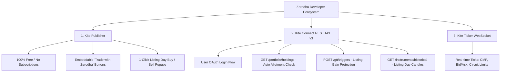
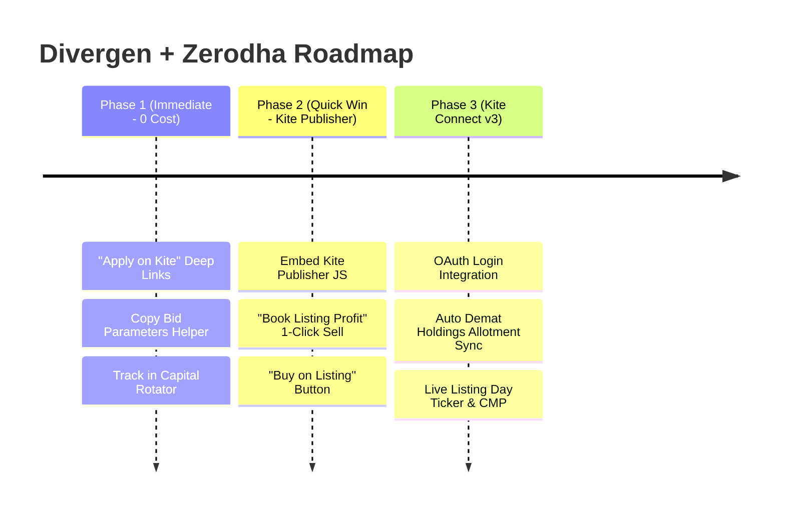

# Zerodha Kite Connect API & Divergen IPO Platform Integration Blueprint

## 1. Executive Summary

**Zerodha Kite Connect** is India’s premier financial market API platform, providing programmatic access to Zerodha’s brokerage infrastructure. It powers platforms like Smallcase, Sensibull, and Streak, handling over 500 million API requests daily.

When evaluating Kite Connect for an **IPO-focused platform like Divergen**, there is a crucial architectural distinction you must know:
1. **Can we submit IPO bids programmatically via API?** 
   **No.** Due to SEBI and NPCI regulations, all retail IPO applications require two-factor UPI ASBA authorization or net-banking block approvals. Zerodha restricts IPO applications to their own UI (`kite.zerodha.com/bids/ipo` and `console.zerodha.com/portfolio/ipos`) and does **not** expose public bidding endpoints to 3rd-party APIs.
2. **Can Kite API dramatically enhance Divergen’s user experience for IPO investors?** 
   **YES — especially in allotment tracking, listing-day execution, and portfolio automation.**

By integrating Kite Connect and Zerodha's free **Kite Publisher** suite, Divergen can bridge the gap from "research and recommendation" to "execution and listing profit realization."

---

## 2. Kite Connect API Suite Overview

Zerodha divides its API offerings into three distinct layers:



### Key API Capabilities & Endpoints

| API Module | Endpoint | IPO / Stock Use Case | Cost |
| :--- | :--- | :--- | :--- |
| **Kite Publisher** | `publisher.js` / HTML5 `<kite-button>` | 1-Click "Sell Allotment" or "Buy on Listing" button embedded in Divergen. | **Free (₹0)** |
| **Portfolio Holdings** | `GET /portfolio/holdings` | Automatically check if allotted IPO shares have been credited to the user's Demat account. | Personal: Free / Connect: ₹500/mo |
| **Market Quotes** | `GET /quote?i=NSE:XYZ` | Live listing day Current Market Price (CMP), listing open price, Day High/Low. | Connect: ₹500/mo |
| **Historical Data** | `GET /instruments/historical/:token/:interval` | Intraday (1m, 5m, 15m) and daily candle data to plot post-listing charts. | Included in ₹500/mo Connect |
| **GTT (Good Till Triggered)** | `POST /gtt/triggers` | Create automated stop-loss / target profit triggers for freshly listed shares. | Personal: Free |
| **Orders** | `POST /orders/regular` | Secondary market delivery (CNC) and intraday order placement. | Included in API |

---

## 3. High-Value Workflows to Add to Divergen

Here are 5 concrete features designed specifically around IPOs and listing day management that you can implement in Divergen:

---

### Workflow 1: 1-Click "Apply on Zerodha" Deep-Link & Bid Helper
*(Immediate Implementation — 0 Cost, 0 API Token overhead)*

* **The Problem:** Divergen gives users a clear `APPLY` recommendation and suggests optimal lot sizes, but the user has to leave the app, open Kite, find the IPO, and type everything manually.
* **The Solution:** 
  On Divergen's active IPO detail drawer (e.g. when status is `bidding`), add an **"Apply via Zerodha Kite"** action.
  - Clicking this automatically opens `https://kite.zerodha.com/bids/ipo` directly in a clean tab or popup.
  - Divergen displays a 1-click **"Copy Bid Parameters"** card showing:
    - *Cut-off Price: ₹500*
    - *Minimum Lot: 30 Shares*
    - *Total Block: ₹15,000*
  - It seamlessly prompts the user: *"Did you submit your bid on Zerodha?"* -> Clicking *"Yes"* automatically logs the application into Divergen's **Capital Rotator** and multi-PAN tracker!

---

### Workflow 2: Automated Allotment Detection via Kite Holdings
*(Eliminates Registrar Captcha Hell)*

* **The Problem:** 
  On allotment day, IPO applicants have to refresh registrar sites (Link Intime, KFintech, Bigshare) dozens of times, solving broken captchas while servers crash under load.
* **The Kite Connect Solution:**
  When an IPO is allotted, the depository (CDSL/NSDL) credits the shares to the applicant's Demat account roughly 24 hours before listing day.
  1. The user connects their Zerodha account once via Kite Connect OAuth.
  2. Divergen checks `GET /portfolio/holdings`.
  3. When an ISIN or symbol matching the IPO appears in the response:
     - Divergen triggers an instant notification:  
       🎉 **"Allotment Confirmed! You received 1 lot (30 shares) of Premier Energies in Zerodha at ₹450/share."**
     - Divergen automatically updates the Family PAN status from `Applied` to `Allotted` without the user typing a single captcha!

---

### Workflow 3: Kite Publisher "1-Click Listing Gain Exit"
*(Zero Monthly Fees, Ready-to-Use JavaScript SDK)*

* **The Problem:**
  Retail IPO investors often hold an IPO strictly for listing day gains (flipping). On listing morning (10:00 AM), they need to quickly sell their allotted lot to lock in the 30%–80% profit.
* **The Kite Publisher Solution:**
  On Divergen's Listed IPO page or Allotment Tracker:
  - Divergen renders an official, exchange-approved Kite Publisher button:
    ```html
    <kite-button 
        data-kite="your_api_key"
        data-exchange="NSE" 
        data-tradingsymbol="SWIGGY" 
        data-transaction_type="SELL" 
        data-quantity="30" 
        data-order_type="MARKET">
        Book Listing Gain on Kite
    </kite-button>
    ```
  - When the user clicks, an official, secure Zerodha popup modal slides in over Divergen.
  - The user confirms their sale in 2 seconds. The order is executed on NSE at market price.

---

### Workflow 4: Real-Time Listing Day Tracker (CMP vs Issue Price)
*(Brings Live Stock Performance to Divergen)*

* **The Problem:** Currently, Divergen tracks GMP and static listing estimates. Once an IPO lists, users want to see real-time price action and post-listing performance.
* **The Kite Connect Solution:**
  - Using Kite Connect Quotes (`GET /quote?i=NSE:XYZ`) or Historical Data:
    - Display live **Current Market Price (CMP)**.
    - Calculate **Live Listing Gain %**:  
      $$\text{Live Gain} = \frac{\text{CMP} - \text{Issue Price}}{\text{Issue Price}} \times 100$$
    - Render an intraday 5-minute candlestick chart using BKlit AreaChart / BarChart showing whether institutional buyers are accumulating or retail investors are dumping shares on Day 1.

---

### Workflow 5: "Listing Gain Protector" via Kite GTT (Good Till Triggered)
*(Automated Risk Management for IPO Flippers)*

* **The Problem:** 
  Users who cannot watch the market at 10:00 AM fear a listing crash (e.g. listing at +30% then falling to -5%).
* **The Kite Connect Solution:**
  Divergen can offer an automated **Listing Gain Protection Preset**:
  - *"Lock Listing Profit"*: Divergen prepares a GTT OCO (One-Cancels-Other) order:
    - **Stop-Loss Trigger**: Issue Price + 10% (guarantees capital protection).
    - **Target Trigger**: Issue Price + 50% (locks in target gain).
  - Submitted via `POST /gtt/triggers` to Zerodha. Even if the user is in a meeting, Zerodha's server triggers the sell order the second the price crosses the threshold.

---

## 4. Technical Comparison: Kite Publisher vs Kite Connect

| Criteria | Kite Publisher | Kite Connect Full API |
| :--- | :--- | :--- |
| **Primary Purpose** | Branded trade buttons / basket orders embedded on websites | Full programmatic trading, WebSocket streaming, and portfolio data |
| **Cost** | **₹0 / Free forever** | **₹500 / month** (Includes historical data & WebSocket) |
| **Authentication** | Handled inside Zerodha's secure popup modal (Zero auth server needed) | OAuth 2.0 flow (Requires backend to store API secret & exchange tokens) |
| **Token Expiry** | None (User logs in during the popup modal) | Daily at 6:00 AM IST (SEBI regulation mandates daily re-login) |
| **Regulatory Burden** | None (Exchange-approved widget) | Must comply with SEBI broker API and algorithmic trading circulars |
| **Setup Time** | **< 30 minutes** | 2–3 days for backend OAuth + token storage |
| **Best For** | 1-Click "Sell Allotment" or "Buy on Listing" | Live allotment sync, live streaming prices, and GTT automation |

---

## 5. Phased Implementation Roadmap for Divergen



### Phase 1: Deep Linking & Bid Copier (Ship in 1 Day)
1. Add a direct `Apply on Zerodha` CTA in `Active IPO Drawer`.
2. Direct link: `https://kite.zerodha.com/bids/ipo`.
3. Provide a copyable summary card (Issue Price, Lot Size, Cut-off).
4. Auto-update Capital Rotator when user confirms they applied.

### Phase 2: Kite Publisher Integration (Ship in 2 Days)
1. Sign up on [developers.kite.trade](https://developers.kite.trade) to generate a free API key.
2. Add `<script src="https://kite.trade/publisher.js?v=3"></script>` to `index.html`.
3. Create a reusable React component `KiteTradeButton.jsx`.
4. Embed on `Listed` IPO cards for 1-click buy/sell.

### Phase 3: Kite Connect Portfolio Sync (Advanced Roadmap)
1. Subscribe to Kite Connect tier (₹500/month).
2. Implement backend endpoint `/api/zerodha/auth` and `/api/zerodha/holdings`.
3. Match holding ISINs against Divergen's IPO database to deliver automated allotment alerts.
